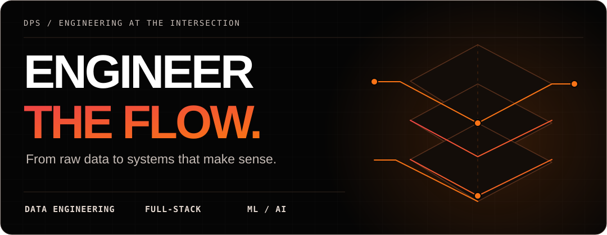
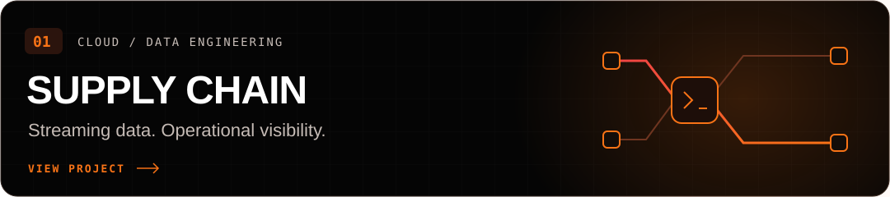
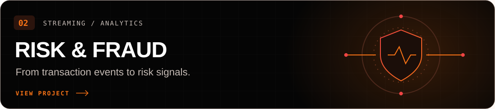
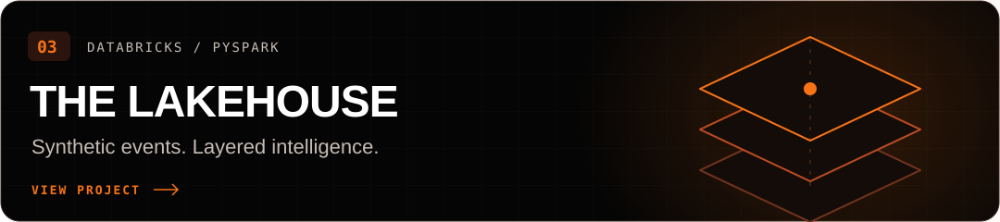
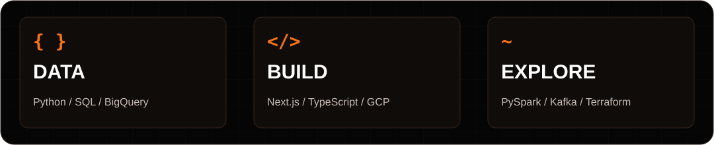

# Dhruv Pratap Singh

[Selected work](#selected-work) · [Toolkit](#toolkit) · [Background](#background)

  

  
  
  

**Data engineer. Full-stack builder. Always connecting the dots.**

I build cloud pipelines, analytical models, and the applications that bring them together. My focus: turning raw data into something people can use.

## Selected work

### 01 / Move data. Make it visible.

  

**[Supply Chain & Fleet Analytics](https://github.com/iamdpsingh/Project-5-Enterprise-Supply-Chain-Logistics-Data-Platform-with-Real-Time-Fleet-Analytics-on-GCP)**

A Bronze → Silver → Gold platform on Google Cloud, connecting IoT fleet telemetry to a Next.js control tower. Built around the journey from streaming events to operational visibility.

`Pub/Sub → Dataflow → BigQuery → Next.js`

### 02 / Turn events into decisions.

  

**[Financial Risk & Fraud Detection](https://github.com/iamdpsingh/Project-4-Financial-Risk-Fraud-Detection-Data-Platform)**

Batch and streaming pipelines with a seven-rule fraud scoring engine. Apache Beam handles event processing; dbt and Airflow support transformation and orchestration.

`GCS + Pub/Sub → Apache Beam → BigQuery → Streamlit`

### 03 / Explore the lakehouse.

  

**[Databricks Data Intelligence Platform](https://github.com/iamdpsingh/Enterprise-Databricks-Lakehouse-Real-Time-Data-Intelligence-Platform)**

A GCP-hosted lakehouse exploring streaming and data intelligence with Serverless PySpark and Delta Lake. Uses synthetic data modeled after Web3, GitHub Archive, and mapping datasets.

`Synthetic events → PySpark → Delta Lake → Next.js`

Explore previous projects — data, applications, and hardware

**Data pipelines & analytics**

- **[E-commerce Analytics Pipeline](https://github.com/iamdpsingh/Project-3--E-commerce-Analytics-Pipeline)** — GCS-to-BigQuery ELT, a star schema, and a Streamlit analytics dashboard.
- **[Weather Data Pipeline](https://github.com/iamdpsingh/Project-2--Weather-Data-Pipeline)** — REST API ingestion, incremental PostgreSQL loads, and scheduled processing.
- **[Vendor Performance Analysis](https://github.com/iamdpsingh/Vendor_Performance_Analysis)** — purchase, sales, and logistics analysis with Python, Pandas, and SQL.
- **[House Price Prediction](https://github.com/iamdpsingh/House-Price-Prediction-Web-App)** — Random Forest and XGBoost regression served through Flask.

**Applications & AI**

- **[Zoomer](https://github.com/iamdpsingh/Zoomer)** — video conferencing and meeting management. [Live demo](https://zoomer-dps.vercel.app/).
- **[Gemini Chatbot](https://github.com/iamdpsingh/AI5-chatbot-gemini)** — multi-turn conversations with a Streamlit interface.
- **[Career Intelligence & Personal Brand Autopilot](https://github.com/iamdpsingh/Career-Intelligence-Personal-Brand-Autopilot)** — career tracking and personal branding with Next.js and TypeScript.

**IoT & hardware**

- **Smart Cane for Visually Impaired** — obstacle detection with haptic and audio feedback, GPS, and GSM using Arduino and Raspberry Pi 3.
- **Home Automation System** — servo and ultrasonic sensors, RGB lighting, and TV automation.
- **Room Heater with Controlled Humidification** — temperature and humidity regulation using Arduino and a DHT11 sensor.

[Browse all repositories](https://github.com/iamdpsingh?tab=repositories)

## Toolkit

  

**Data & orchestration** 
Python · SQL · BigQuery · Airflow · dbt · Pandas

**Cloud & applications** 
Google Cloud · PostgreSQL · Next.js · TypeScript · FastAPI · Flask

**Analytics & ML** 
Power BI · Scikit-learn · XGBoost · Matplotlib · Seaborn

**Currently exploring** 
PySpark · Kafka · Docker · Terraform

Additional tools from my projects and coursework

R, NumPy, Jupyter, SciPy, TensorFlow, PyTorch, OpenCV, Tableau, Databricks, Apache Spark, Delta Lake, Kubernetes, Linux, Raspberry Pi, MySQL, MongoDB, React, Node.js, JavaScript, and GitHub.

## Background

**Data Science Intern · Krutanic Solutions** 
Remote · August–November 2025

Worked on data cleaning and exploratory analysis with Python, Pandas, and SQL; regression, classification, and time-series modeling; and stakeholder dashboards and automated reporting.

**B.Tech, Computer Science · GLA University, Mathura** 
2022–2026

Education & certifications

- **Earlier education:** Agra Vanasthali Vidyalaya, Agra — Class XII (2022); Christ The King High School, Tundla — Class X (2020).
- **Infosys Springboard:** Basics of Python; Programming Fundamentals using Python.
- **NPTEL:** E-Business; Management Information System; Software Engineering; Ethics in Engineering.
- **GLA CSED:** Intro to IoT; IIoT Communication; Smart Industrial Connectivity; Data Science & Analytics; ML for IIoT.
- **GLA University:** Job Oriented Value Added Course.
- **DataCamp:** Introduction to R (April 2025).

---

**Let’s build something useful.** 
Interested in remote opportunities across data engineering, analytics, data science, and data QA. [Get in touch](mailto:dhruvpratapsingh30.official2.o@gmail.com).
